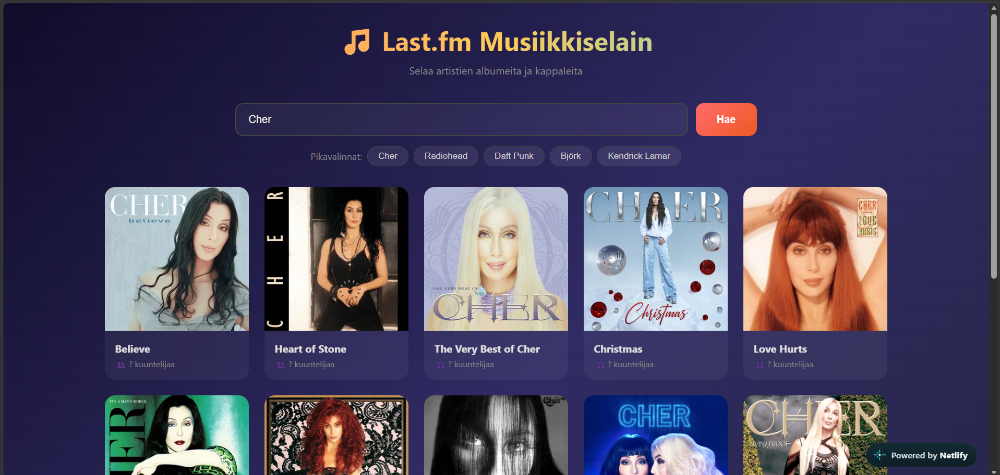

# Projekti 2a

**Tekijä(t):** Ivona Aksamentova ja Ekaterina Porkka

## Projektisuunnitelma

### Projektin idea

Kuvaile lyhyesti, mitä sovelluksesi tekee ja kenelle se on tarkoitettu.

### Suunnitellut toiminnot

Listaa vähintään kolme sovellukseesi suunniteltua toimintoa:

- Toiminto 1 Etsiä laulajia ja bändejä
- Toiminto 2 Löytää niiden albumeja ja nähdä niissä olevat laulut
- Toiminto 3 Katsoa kuinka suosittuja ne ovat

### Rautalankamalli / luonnos

-

## Verkkolinkit

- **Julkaistu sovellus:** https://meek-sfogliatella-386317.netlify.app
- **GitHub-repositorio:** https://github.com/iva00001/Projekti-2a/blob/main/README.md
- **Projektin videoesittely:** [Lisää tähän videon osoite](https://example.com/)

## Tietoja sovelluksesta

**[Last.fm Musiikkiselain]** on verkkosovellus, jossa selataan artistien albumeja ja kappaleita

## Teknologiat

Kuvaile, mitä teknologioita käytit ja mikä niiden rooli oli projektissasi.

- HTML – sivun rakenne
- CSS – ulkoasu ja asettelu
- JavaScript – toiminnallisuus, DOM-skriptaus ja lomakkeiden validointi

## Sovelluksen käyttö

Kirjoita lyhyet käyttöohjeet sovellukselle.

1. Avaa julkaistu sovellus yllä olevasta linkistä.
2. Täytä haku lomakkeen kenttä tai valitse pikavalinta.
3. Katso artistin albumeita, kappaleita ja kuinka suositut ne ovat.

## Kuvakaappaukset

[Kuvakaappaus sovelluksesta] 

## Tunnetut virheet / puutteet

Albumin kannessa ei näy sen kuuntelijoiden määrä ja albumin sisällä ei näy julkaistuksen päivämäärä

## Työn jakautuminen

- Ivona Aksamentova: JavaScript koodaminen
- Ekaterina Porkka: CSS

## Oma arvio ja oppimisen reflektointi

Pohdi työtäsi ja oppimisprosessiasi.

- Missä onnistuin? Sivuston toimivuus
- Mikä oli haastavaa? Parityöskentely GitHubissa ja Netlify käyttö
- Mitä parantaisin, jos aikaa olisi enemmän? Olisimme lisäneet function jolla pääse suoraan kuuntelemaan kappalleen 
- Mitä opin HTML:stä, CSS:stä, JavaScriptistä ja DOM-skriptauksesta? Paransimme JavaScriptin käyttöä ja sen ymmärrystä
- Mikä jäi epäselväksi tai mistä haluaisin oppia lisää? GitHub
- Oma arvio projektista: **8/10 pistettä**

## Lähteet ja kiitokset

- Käytetty tekoälytyökalu: ChatGpt
  - Miten työkalua käytettiin: Auttoi Netlify yhdistyksen kanssa. Se ehdotti lisätä pikavalinnan suosittuille artistteille

  ## Lisenssi

Tämä projekti on lisensoitu MIT-lisenssillä.

Lisätietoa lisenssin lisäämisestä GitHub-projektiin:
https://docs.github.com/en/communities/setting-up-your-project-for-healthy-contributions/adding-a-license-to-a-repository